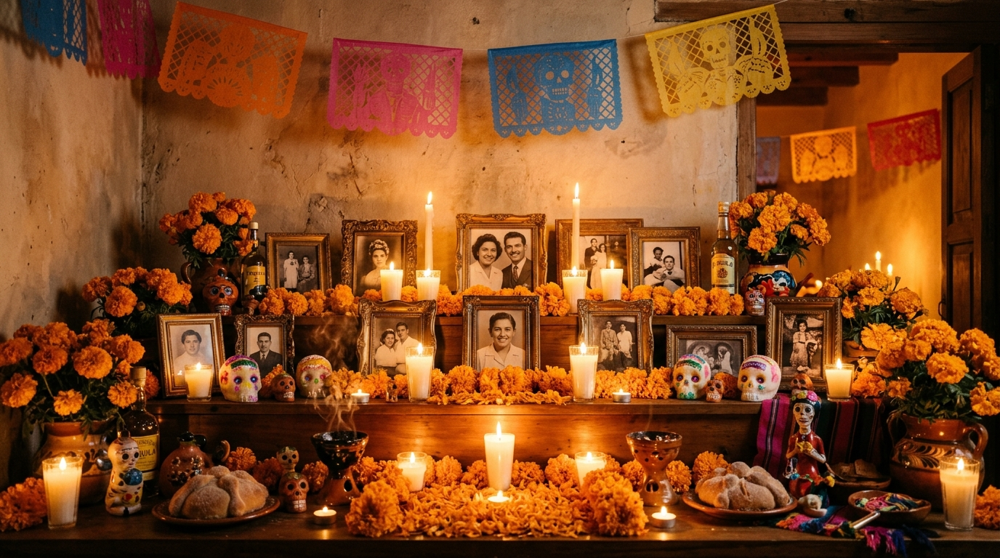

# 🕯️ Ofrenda: The Offline Memory Altar

> **A local-first, air-gapped conversational remembrance companion for Día de los Muertos, powered by open-source AI and offline RAG.**  
> Built for the **Ghost in the Machine** Hackathon Challenge.



---

## 🌟 Concept

In the tradition of **Día de los Muertos** (November 1–2), families set an *ofrenda* (altar) adorned with cempasúchil marigolds, framed portraits, and flickering candles to welcome back the memories of those who passed away.

**Ofrenda** brings this tradition into the digital age with strict ethical reverence:
1. **Intimate Oral History:** You drop in digitized family journals, handwritten letters, old recipes, or transcribed voice recordings.
2. **Sacred Conversational Vigil:** By lighting a virtual candle in an amber-lit interface, you converse with an "echo" of your loved one's archived stories.
3. **100% On-Device & Air-Gapped:** Not a single word, photo, or memory ever leaves your computer. No cloud servers, no third-party APIs, and zero telemetry.

---

## 🛠️ The Open-Source Stack

- **Model:** **Qwen2.5-7B-Instruct (Q4_K_M)** — High-fidelity instruction following, empathetic narrative tone, and fluent English/Spanish bilingual capability.
- **Inference Runtime:** **Ollama (`llama.cpp`)** — Self-hosted, cross-platform engine with zero-friction GPU offloading and zero external telemetry.
- **Vector Database:** **ChromaDB** — In-process SQLite-backed vector store running locally in `./data/chroma_db/`.
- **Embeddings:** **FastLocalEmbedding** — 100% offline, zero-download subword projection vectorizer generating 384-dimensional dense vectors with zero network dependencies.
- **Backend Server:** **FastAPI + Uvicorn** — Ultra-fast Python ASGI server delivering Server-Sent Events (SSE) token streaming.
- **Frontend Design:** **Vanilla HTML5 + CSS3 + JavaScript** — Atmospheric glassmorphism, dynamic SVG candle flicker, floating cempasúchil marigold particle physics, and responsive layouts.

---

## 🚀 Quickstart Guide

### 1. Launch the Application (Instant Run)
All required core packages (`fastapi`, `uvicorn`, `chromadb`, `numpy`, `httpx`) are already configured. Simply run:

```bash
python run.py
```

Your browser will automatically open to `http://127.0.0.1:8000`.

> **Note:** On first launch, Ofrenda runs seamlessly in **Built-in Local Echo Mode**, allowing you to explore the interface, test RAG citations, and interact with the pre-loaded memories of **Abuela Elena**, **Abuelo Mateo**, and **Tía Sofía** immediately with zero downloads!

---

### 2. Connect to Local Ollama & Qwen2.5 (Full Local Open-Weights)
To power the altar with the full 7-billion-parameter open-weight model:

1. Download and install [Ollama](https://ollama.com/) (if not already installed).
2. In your terminal, pull and run the model:
   ```bash
   ollama run qwen2.5:7b-instruct-q4_K_M
   ```
3. In the Ofrenda web interface, click **⚙️ Settings** and select **Ollama (Local Open-Weight Model)**. The system will automatically detect the local port (`http://localhost:11434`) and route all inferences through your GPU/CPU!

---

## 📂 Project Structure

```
├── backend/
│   ├── app.py                   # FastAPI application serving REST API & SSE streams
│   ├── rag_engine.py            # Local ChromaDB semantic search & grounding verification
│   ├── llm_provider.py         # Multi-backend adapter (Ollama, LM Studio, Local Echo)
│   ├── memory_manager.py       # Local file parser, indexer, and persistence manager
│   ├── embeddings.py           # 100% offline subword semantic vectorizer
│   └── models.py                # Pydantic schemas for queries, citations, and status
├── frontend/
│   ├── index.html               # Semantic HTML5 layout with accessible elements
│   ├── style.css                # Bespoke vanilla CSS: glassmorphism, candle glow, dark mode
│   ├── app.js                   # Client-side reactivity: SSE streaming, canvas particles
│   └── assets/
│       └── ofrenda_bg.jpg       # Photographic altar visual centerpiece
├── memories/                    # Pre-loaded curated authentic family archives
│   ├── abuela_elena.txt         # Pan de muerto recipe, Oaxaca memoirs, boleros
│   ├── abuelo_mateo.txt         # Coyoacán guitar workshop, 1985 earthquake solidarity
│   └── tia_sofia.txt            # Monarch butterflies in Michoacán, herbal remedies
├── data/
│   └── chroma_db/               # Persistent on-device ChromaDB vector database
├── CHALLENGE_POST.md            # The complete essay: "Why Open Innovation Matters"
├── LICENSE                      # MIT Open-Source License
├── requirements.txt             # Clean list of Python dependencies
├── run.py                       # One-command quickstart launcher
└── README.md                    # Project documentation
```

---

## 📜 Why Open Innovation Matters for This Project

See the full submission essay in [CHALLENGE_POST.md](file:///d:/aaa/AI/New%20folder/CHALLENGE_POST.md) or click the **✨ Open Innovation Post** button inside the web app.

### Core Arguments:
1. **Grief is not training data:** Private family memories, letters, and recipes should never be uploaded to commercial cloud APIs.
2. **Weights outlive cloud vendors:** A model stored on your local drive can be run 20 years from now; a startup's cloud API will not last forever.
3. **Sovereign Persona Control:** Open weights allow genuine cultural reverence without corporate sanitization or false-positive safety refusals around death.

---

## 🛡️ Privacy & Air-Gap Verification
- Outgoing internet requests during execution: **0**
- Third-party telemetry: **None**
- In-process SQLite & disk storage: **100% Local**

---

## 📄 License
This project is open-source software licensed under the [MIT License](LICENSE).
